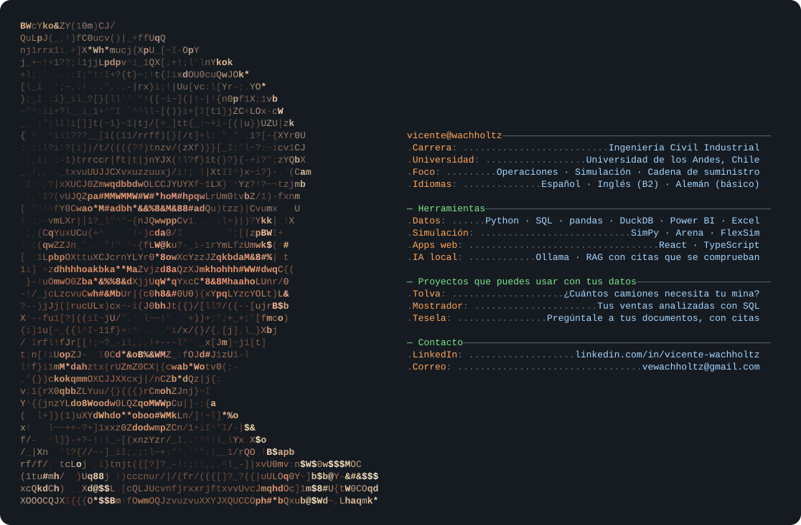

### Proyectos

| | Qué hace | |
|---|---|---|
| **[Tolva](https://github.com/vewachholtz-ops/simulacion-carguio-minero)** Simulación de carguío minero | Simulación de camiones, palas, colas y fallas. Compara producción y costo por tonelada entre distintas flotas. | [Abrir](https://vewachholtz-ops.github.io/simulacion-carguio-minero/) |
| **[Mostrador](https://github.com/vewachholtz-ops/analisis-ventas-sql)** Ventas con SQL | Análisis de ventas, productos y clientes con consultas SQL. Incluye una papelería chilena simulada y permite cargar CSV o Excel. | [Abrir](https://vewachholtz-ops.github.io/analisis-ventas-sql/) |
| **[Tesela](https://github.com/vewachholtz-ops/rag-documentos-local)** Cuadernos para documentos | Consulta de documentos con citas a las fuentes, conversaciones y notas. Búsqueda sin IA, modelos locales o conexión a una API. | [Abrir](https://vewachholtz-ops.github.io/rag-documentos-local/app/) [Instalar](https://github.com/vewachholtz-ops/rag-documentos-local#instalar) |

  
  

